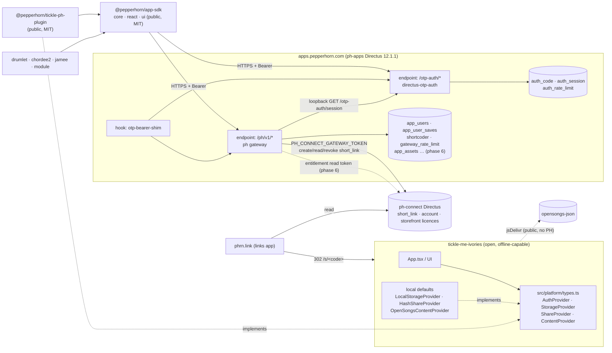

# PepperHorn platform SDK: sign-in, saves, shares and content

Date: 2026-09-26. Status: design, for review. First consumer: tickle-me-ivories.

Inputs: `docs/superpowers/research/2026-09-26-ph-apps-share-auth-audit.md` (the **audit**),
`docs/superpowers/research/2026-09-26-app-sdk-survey.md` (the **survey**), `~/directus-otp-auth`
(README, SPEC.md, `packages/directus/src/{routes,transport,mount,principal-store,mailer}.js`),
ph-apps `internal_architecture` v0.1 (the **arch doc**), `~/pepperhorn-platform/apps/links` (the
**links app**, phrn.link), `pepperhorn/opensongs-json`, and tickle's `src/settings/profile.ts`.

---

## 0. Binding decisions and how this design reads them

| # | Decision (user) | Consequence here |
|---|---|---|
| D1 | drumlet, chordee2, jamee, module **and dottl** move from the legacy Flow OTP to directus-otp-auth; legacy Flows retire afterwards | Phase 4 migrates all five, and phase 5 retires the Flows. dottl was added by a later decision (formerly Q1). |
| D2 | The SDK targets directus-otp-auth only | No `flow-legacy` transport, unlike the survey's §5 suggestion. |
| D3 | `@pepperhorn/app-sdk` is public (MIT) and is the PepperHorn client | It holds no secrets and makes no gate decisions. Every check runs on the server. |
| D4 | Open apps stay backend-independent | tickle defines `AuthProvider`/`StorageProvider`/`ShareProvider`/`ContentProvider` and never imports `@pepperhorn/*`. `@pepperhorn/tickle-ph-plugin` implements them and is loaded by deploy config. |
| D5 | Reuse `app_user_saves` and `shortcoder` behind a ph-apps gateway endpoint; never widen Public or App User grants | §6. The gateway becomes the **only** data path for apps. |
| D6 | Tickle save kinds are `scene` and `look`. A song ref is opensongs id+tag, local content hash, or uploaded MIDI (signed-in only) | §8. Uploaded MIDI is stored as base64 inside the payload (§8.4). |
| D7 | Content can be free, subscription or purchased, per arch doc §3; it is phased after auth, saves and shares | §5.5 and §6.6 define the SDK surface and minimum backend. Phase 6. |
| D8 | ph-apps and ph-connect stay separate Directus instances | They share no tables. They integrate over two scoped service tokens (§6.7, §6.6) and one global person id (D10). |
| D9 | Public short links use phrn.link. `shortcoder` stays authoritative | The gateway writes a `short_link` row (`entity_type: app_share`). The links app 302s to the app's own `/s/<code>` (§6.7). |
| D10 | Identity is linked by `ph_uid`, a uuid minted by directus-otp-auth and stored unique on `app_users` and `account`. Links are made only through a verified session, never by email. Duplicates go to a manual queue | §6.8. This needs an upstream directus-otp-auth feature and a backfill (phase 0 and phase 6). |
| D11 | ph-apps reaches ph-connect with two separately revocable tokens: `ph_apps_gateway` (create, read and status-update `short_link` for `app_share` only) and a read-only entitlement token | §6.7, §6.6. |
| D12 | Purchases are split: the system that sells an item owns its purchase record. There is one Stripe account and one customer per `ph_uid`, and a single entitlement shape that the ph-apps gateway unions | §5.2. Replaces the earlier "mirror on ph-connect" recommendation (formerly Q2, now resolved). |
| D13 | ph-connect status: the `short_link.entity_type` choice `app_share` is **live**. The `ph_apps_gateway` policy is applied **by the user**, with create, read and status-only update, plus an IP allowlist. The token is `PH_CONNECT_GATEWAY_TOKEN` | §6.7. Deleting a share revokes its phrn.link row. |
| D14 | `ph_uid` never appears in a URL and never leaves PepperHorn servers. Public URLs use `user_handle` or share codes | The SDK, the gateway responses and otp-auth public responses omit it. Link tickets are opaque (§6.8). Server-to-server calls carry it in a POST body. The one sanctioned exception is Stripe `metadata.ph_uid` (D12). |
| D15 | Phase 7: third-party access (e.g. forScore) through OAuth 2.0 authorisation code + PKCE, with pairwise subject ids | §13. |
| D16 | OAuth `/authorize` and `/token` live in **directus-otp-auth**, not in Directus's native OAuth server (formerly Q9) | §13. The native MCP OAuth server stays for operator use only. |
| D17 | Pairwise id = `base64url(HMAC(server_secret, ph_uid ‖ client_id))` (formerly Q10) | §13. |
| D18 | Repos: `pepperhorn/pepperhorn-platform` is the monorepo (`~/pepperhorn-platform`; `~/ph-connect-worker` is the same repo). ph-connect is `apps/connect`, phrn.link is `apps/links`, and stamping is `apps/stamp-pdf` | All paths in this spec and the plan use it. |
| D19 | jamee's uploaded files must not be publicly readable (formerly Q4) | §6.3 file rules; a phase 4 task. |
| D20 | Resolved as recommended: `ph_uid` may be null only on unverified draft rows (N1, formerly Q5); tickle's host is `ivories.pepperhorn.com` (the user adds DNS; formerly Q6); chordee keeps `/c/<code>`, and new apps use `/s/<code>` (formerly Q7) | §6.5, §7, §10.2. |

### Findings from the source that shape the design (not divergences from any decision)

- **F1. directus-otp-auth does not create accounts.** Its SPEC §1 says "A principal must already exist to receive a code". The legacy Verify Flow creates `app_users` on first login. **Fix:** the gateway gets an enrolment route, `POST /ph/v1/enroll` (§6.3).
- **F2. The cookie transport cannot serve these apps.** The session cookie is `SameSite=Lax` and path-scoped to `/otp-auth` (`transport.js` `COOKIE_PATH`). The apps live on other sites (`drumlet.app`, `dottl.app`, and tickle's own host), so the browser never sends the cookie cross-site. And even on a same-site host, the gateway at `/ph/*` would never receive a cookie scoped to `/otp-auth`. **Fix:** ph-apps runs `OTP_AUTH_TRANSPORT=bearer` (§6.1, §10.3).
- **F3. Directus core rejects foreign bearer tokens.** Its `authenticate` middleware treats any `Authorization: Bearer` that is neither a Directus JWT nor a static token as invalid credentials. That rejection happens before extension routes run, and it is exactly why the legacy `app-session-auth` hook swaps the header. directus-otp-auth has only ever run in cookie mode (on ph-connect). **Fix:** a small `otp-bearer-shim` hook (§6.1). Phase 0 opens with a spike to prove or disprove F3 on 12.1.1.
- **F4. Version skew.** directus-otp-auth's mount behaviour was verified against Directus 12.2.0 (`mount.js`). ph-apps runs 12.1.1. The phase 0 spike checks the mount on 12.1.1.
- **F5. `app_users` does have a status column.** Its values are `draft | published | archived`, and all 9 live rows are `published`. The directus-otp-auth `.env.example` says ph-apps has none, which is stale. Config: `OTP_AUTH_PRINCIPAL_STATUS_COLUMN=status`, `OTP_AUTH_PRINCIPAL_ACTIVE_VALUES=published,draft`. `archived` means disabled.
- **F6. One mail template serves every app.** directus-otp-auth renders the single file template `OTP_AUTH_EMAIL_TEMPLATE` with the variables `code`, `email` and `app` (the slug), and the subject is hard-coded ("Your sign-in code"). The legacy `email_templates` rows use a different shape (`app_slug`, `template_type`, `body_html`) that directus-otp-auth does not read. **Consequence:** no `email_templates` rows are created. That includes tickle: tickle never gets a legacy OTP row. Per-app branding moves into one Liquid file with `` (§6.2). The legacy `otp` rows are archived in phase 5.
- **F7. opensongs-json has no tags yet** (`GET /repos/pepperhorn/opensongs-json/tags` returns `[]`). A pinned ref is therefore a tag when one exists, and a 40-hex commit SHA otherwise. It is never a branch (§8.2).
- **F8. The arch doc names `app_user_assets` for user libraries,** but the live table is `app_user_saves`. D5 governs, so we keep `app_user_saves`. The arch doc's asset-payload **Flow** is implemented as a gateway **route** instead, for the same reasons the audit gives for shares (crypto, atomic SQL, rate limits). Record this in arch doc v0.2.

---

## 1. Architecture



**Dependency arrows are one-way.** They are:

- plugin → SDK
- plugin → tickle interfaces (a type-only import)
- apps → SDK
- SDK → HTTP

tickle has no arrow to anything `@pepperhorn`. The SDK has no arrow to any app.

**Layers:**

| Layer | Owns | Never does |
|---|---|---|
| tickle `src/platform` | the provider interfaces, the offline defaults, scene/look codecs, untrusted-payload decoding | import `@pepperhorn/*`; require a network |
| tickle-ph-plugin | adapts the SDK to tickle's interfaces; per-kind schemas (`./schema`) shared with the gateway | UI, gate decisions |
| app-sdk `core` | HTTP, token storage, the auth state machine, saves/shares/content clients, zod envelopes | React, secrets, entitlement decisions |
| app-sdk `react` / `ui` | hooks over the core stores; a headless OTP form | styling beyond semantic class hooks |
| ph gateway | session → principal, app_slug scoping, validation, caps, rate limits, share codes, visibility, phrn.link sync, entitlement gate | issuing credentials (that is directus-otp-auth's job) |
| directus-otp-auth | codes, sessions, devices, revocation, `ph_uid` minting and linking | authorisation, account creation |

---

## 2. Tickle provider interfaces (`src/platform/types.ts`, app-owned)

```ts
// ---- shared ----
export type SaveKind = 'scene' | 'look'
export type Visibility = 'private' | 'link_view' | 'link_edit' | 'public'
export type PlatformErrorCode =
  | 'network' | 'unavailable' | 'unauthorized' | 'forbidden' | 'not_found'
  | 'conflict' | 'rate_limited' | 'too_large' | 'invalid' | 'invalid_code'
  | 'upload_requires_sign_in'
export class PlatformError extends Error {
  constructor(readonly code: PlatformErrorCode, message: string, readonly retryAfterSec?: number) { super(message) }
}

// ---- auth ----
export interface PlatformUser { id: string; handle: string; displayName: string | null }
export type AuthState =
  | { status: 'unknown' }                    // restoring
  | { status: 'signed-out'; pendingEmail?: string }
  | { status: 'signed-in'; user: PlatformUser }
export interface AuthProvider {
  readonly id: string
  readonly codeLength: number                // 8 on ph-apps (OTP_AUTH_CODE_DIGITS)
  getState(): AuthState
  subscribe(listener: (s: AuthState) => void): () => void
  requestCode(email: string): Promise<void>  // always resolves for a well-formed email (no enumeration)
  verifyCode(email: string, code: string): Promise<PlatformUser>  // PlatformError('invalid_code')
  signOut(): Promise<void>
  manageAccount?(): void                     // opens the device list (plugin-rendered link/route)
}

// ---- storage (named saves; autosave of tmi.profile.* stays local, always) ----
export interface SaveSummary {
  id: string; kind: SaveKind; name: string; updatedAt: string
  visibility: Visibility; songTitle?: string
}
export type SaveInput =
  | { kind: 'scene'; id?: string; name: string; payload: SceneV1 }
  | { kind: 'look'; id?: string; name: string; payload: LookV1 }
export interface StorageProvider {
  readonly id: string
  readonly remote: boolean
  list(kind: SaveKind): Promise<SaveSummary[]>
  load(kind: 'scene', id: string): Promise<SceneV1 | null>
  load(kind: 'look', id: string): Promise<LookV1 | null>
  save(input: SaveInput): Promise<SaveSummary>   // id minted client-side (crypto.randomUUID) when absent
  remove(kind: SaveKind, id: string): Promise<void>
}

// ---- share ----
export interface ShareResult { code: string; url: string; shortUrl: string | null; revokeKey?: string }
export interface ResolvedShare {
  code: string; kind: SaveKind; payload: unknown     // ALWAYS untrusted, decoded by the host
  owner: { handle: string } | null; visibility: Visibility
  isOwner: boolean; canEdit: boolean; canFork: boolean
}
export interface ShareProvider {
  readonly id: string
  readonly supports: { anonymous: boolean; owned: boolean; revoke: boolean; fork: boolean }
  share(input: { kind: 'scene'; payload: SceneV1 } | { kind: 'look'; payload: LookV1 }): Promise<ShareResult>
  shareSaved?(kind: SaveKind, saveId: string, visibility: Exclude<Visibility, 'private'>): Promise<ShareResult>
  match(loc: { pathname: string; hash: string }): string | null   // '/s/<code>' or '#share=<blob>'
  resolve(code: string): Promise<ResolvedShare | null>
  update?(code: string, payload: SceneV1 | LookV1): Promise<void>  // link_edit
  fork?(code: string, name: string): Promise<SaveSummary>
  revoke?(code: string, revokeKey?: string): Promise<void>
}

// ---- content ----
export type SongRef =
  | { kind: 'opensongs'; id: string; ref: string }                     // ref: tag or 40-hex SHA
  | { kind: 'local'; sha256: string; name: string; format: 'midi' | 'musicxml' }
  | { kind: 'midi'; sha256: string; name: string; dataB64: string }    // signed-in only
  | { kind: 'ph-asset'; assetId: string }                              // phase 6
export type Access = 'free' | 'sign-in' | 'locked' | 'owned'
export interface LibraryItem {
  ref: SongRef; title: string; composer: string | null
  difficulty: number | null; tags: string[]; access: Access
  cta?: { label: string; href: string }                                // "Subscribe to unlock"; UI only
}
export interface LoadedSong { score: ScoreDocument; songKey: string; attribution: string | null }
export interface ContentProvider {
  readonly id: string; readonly label: string
  handles(ref: SongRef): boolean
  list(q: { search?: string; cursor?: string; limit?: number }): Promise<{ items: LibraryItem[]; next: string | null }>
  load(ref: SongRef): Promise<LoadedSong>                              // PlatformError('forbidden') when gated
}

// ---- plugin contract ----
export interface TickleHost {
  appVersion: string
  origin: string                                    // for share URLs: `${origin}/s/<code>`
  decodeScene(u: unknown): SceneV1                  // throws; the app's own validators (§9.1)
  decodeLook(u: unknown): LookV1
}
export interface TicklePlugin {
  id: string; name: string; version: string
  auth?: AuthProvider; storage?: StorageProvider; share?: ShareProvider
  content?: ContentProvider[]
}
export type ActivatePlugin = (host: TickleHost) => TicklePlugin | Promise<TicklePlugin>
```

**Registry (`src/platform/registry.ts`):**

```ts
export interface Platform {
  auth: AuthProvider | null
  storage: StorageProvider
  share: ShareProvider
  content: ContentProvider[]
}
export function getPlatform(): Platform
export function subscribePlatform(l: () => void): () => void
export function installPlugin(p: TicklePlugin): void     // plugin providers replace or extend the defaults
export async function loadConfiguredPlugins(host: TickleHost): Promise<void>
```

- The defaults are `LocalStorageProvider`, `HashShareProvider` and `[OpenSongsContentProvider]`, with `auth: null`.
- `loadConfiguredPlugins` fetches `/tickle.config.json` (or `VITE_TICKLE_CONFIG_URL`), shaped `{ plugins: string[] }`.
- Each entry must be a **same-origin** module URL. Anything cross-origin is refused. Each is loaded with `import(/* @vite-ignore */ url)` and must default-export `ActivatePlugin`.
- A 404, a network error or a failed plugin logs and leaves the defaults in place. The app never blocks on it.
- The PepperHorn deployment ships `public/tickle.config.json` and `public/plugins/tickle-ph-plugin.js`, copied in from the plugin's release. The open repo ships no config file.

**Offline defaults (in tickle):**

| Provider | Behaviour |
|---|---|
| `LocalStorageProvider` | Keys `tmi.saves.<kind>.<id>` plus an index at `tmi.saves.index`. `remote:false`. Every load goes through `decodeScene`/`decodeLook`. |
| `HashShareProvider` | `share()` returns `${origin}/#share=<base64url(deflate-raw(JSON))>`, using `CompressionStream`. It refuses over 8 KiB encoded, and refuses `song.kind==='midi'` with `too_large`. `resolve` decodes the blob. `supports.anonymous` only. |
| `OpenSongsContentProvider` | Reads jsDelivr (§8.2). Not a PepperHorn backend, and it degrades to empty when offline. |

---

## 3. SDK package: `@pepperhorn/app-sdk` (repo `pepperhorn/app-sdk`, MIT)

**Build:** tsup, ESM plus `.d.ts`, with three entry points: `.` (core), `./react` and `./ui`. The peer dependencies are `zod >=3.25 <5` (imported from `zod/v4`) and `react >=19` (for `react`/`ui` only). Core has zero runtime dependencies besides zod.

```
src/
  core/
    client.ts        createPepperhornClient, http(), PhError mapping (drumlet friendlyError/isNetworkError)
    token-store.ts   TokenStore, localStorageTokenStore, memoryTokenStore
    auth.ts          AuthStore (module-pattern singleton per client: Set<Listener>)
    otp-flow.ts      in-flight OTP persistence (drumlet: {step,email,codeSentAt}, 10 min TTL)
    saves.ts         SavesClient
    shares.ts        SharesClient, parseShareCode
    content.ts       ContentClient (phase 6)
    schemas.ts       zod envelopes (payload stays generic)
    types.ts
  react/
    PhProvider.tsx   context holding one PhClient
    useAuth.ts       useSyncExternalStore over AuthStore
    useSaves.ts      imperative list/load/save/remove
    useSyncedSaves.ts  module's offline-first debounced sync (opt-in)
    useShareFromUrl.ts
    useEntitlements.ts (phase 6)
  ui/
    useOtpForm.ts    step machine: email → code → done; resend cooldown; paste across digits
    OtpDigits.tsx    headless render-prop, emits .ph-otp-digit / .ph-otp-form class hooks
```

### 3.1 Core API

```ts
export interface PhClientOptions {
  appSlug: string                                  // must be in OTP_AUTH_APP_SLUGS and the gateway registry
  baseUrl?: string                                 // default 'https://apps.pepperhorn.com'
  appVersion?: string
  deviceLabel?: string
  tokenStore?: TokenStore                          // default localStorageTokenStore(`ph.session.${appSlug}`)
  fetch?: typeof fetch
}
export function createPepperhornClient(o: PhClientOptions): PhClient
export interface PhClient {
  readonly appSlug: string
  auth: AuthStore; saves: SavesClient; shares: SharesClient; content: ContentClient
}

export interface TokenStore { get(): string | null; set(token: string, expiresAt: string): void; clear(): void }
export function localStorageTokenStore(key: string): TokenStore      // guarded try/catch
export function memoryTokenStore(): TokenStore

export type PhErrorCode = 'network' | 'unavailable' | 'unauthorized' | 'forbidden' | 'not_found'
  | 'conflict' | 'rate_limited' | 'too_large' | 'invalid' | 'invalid_code' | 'upload_requires_sign_in'
  | 'server'
export class PhError extends Error { code: PhErrorCode; status?: number; retryAfterSec?: number }
// The message is always user-safe: 5xx maps to generic text; the raw server text is never surfaced.

export interface AuthUser {                       // never carries ph_uid (D14)
  id: string; email: string; handle: string
  firstName: string | null; lastName: string | null
}
export type AuthSnapshot =
  | { status: 'unknown' }
  | { status: 'signed-out'; pending: { email: string; codeSentAt: number } | null }
  | { status: 'signed-in'; user: AuthUser; expiresAt: string }
export interface Device {
  id: string; appSlug: string; label: string | null; userAgent: string | null
  lastAccessAt: string | null; expiresAt: string; current: boolean
}
export interface AuthStore {
  getSnapshot(): AuthSnapshot
  subscribe(l: () => void): () => void
  restore(): Promise<AuthSnapshot>     // GET /otp-auth/session?appSlug. Keeps the token on network/5xx; clears only on 401
  requestCode(email: string): Promise<void>        // POST /ph/v1/enroll, then POST /otp-auth/code
  verifyCode(email: string, code: string): Promise<AuthUser>   // POST /otp-auth/verify, then GET /ph/v1/me
  signOut(): Promise<void>                         // POST /otp-auth/logout {appSlug}; clears the token even on failure
  signOutEverywhere(): Promise<number>             // POST /otp-auth/logout-all
  devices(): Promise<Device[]>                     // GET /otp-auth/sessions?appSlug
  revokeDevice(id: string): Promise<void>          // DELETE /otp-auth/sessions/:id?appSlug
  updateProfile(p: Partial<Pick<AuthUser, 'firstName' | 'lastName' | 'handle'>>): Promise<AuthUser>
  authorizedFetch(input: string, init?: RequestInit): Promise<Response>  // escape hatch (jamee/dottl files)
}

export interface SaveRow<T> {
  id: string; appSlug: string; kind: string; externalId: string; name: string
  payload: T; visibility: Visibility; forkedFrom: string | null
  createdAt: string; updatedAt: string
}
export type SaveSummaryRow = Omit<SaveRow<never>, 'payload'> & { bytes: number }
export interface SavesClient {
  list(q: { kind?: string; cursor?: string; limit?: number }): Promise<{ items: SaveSummaryRow[]; next: string | null }>
  get<T>(kind: string, externalId: string, schema?: z.ZodType<T>): Promise<SaveRow<T> | null>
  upsert<T>(i: { kind: string; externalId: string; name: string; payload: T;
                 visibility?: Visibility; ifUpdatedAt?: string }): Promise<SaveRow<T>>  // 409 conflict
  setVisibility(kind: string, externalId: string, v: Visibility): Promise<void>
  remove(kind: string, externalId: string): Promise<void>
  listPublic(q: { kind: string; cursor?: string }): Promise<{ items: PublicSave[]; next: string | null }>
}

export interface ShareCreated { code: string; url: string; shortUrl: string | null; revokeKey?: string }
export interface ResolvedShare<T> {
  code: string; appSlug: string; kind: string; payload: T
  owner: { handle: string } | null; visibility: Visibility
  isOwner: boolean; canEdit: boolean; canFork: boolean
  viewCount: number; createdAt: string
}
export interface SharesClient {
  createAnonymous<T>(i: { kind: string; payload: T }): Promise<ShareCreated>   // works signed-out
  createFromSave(i: { kind: string; externalId: string;
                      visibility: Exclude<Visibility, 'private'> }): Promise<ShareCreated>
  resolve<T>(code: string, schema?: z.ZodType<T>): Promise<ResolvedShare<T> | null>
  update<T>(code: string, payload: T): Promise<void>                           // link_edit or owner
  fork<T>(code: string, i: { externalId: string; name: string }): Promise<SaveRow<T>>
  revoke(code: string, revokeKey?: string): Promise<void>
}
export function parseShareCode(pathname: string, pattern?: RegExp): string | null  // default /^\/s\/([A-Za-z0-9]{10})\/?$/
```

- `ContentClient` is phase 6 (§5.5).
- `schemas.ts` exports `VisibilitySchema`, `AuthUserSchema`, `SaveRowSchema(payload)`, `SaveSummarySchema`, `ShareCreatedSchema`, `ResolvedShareSchema(payload)`, `DeviceSchema`, `ErrorBodySchema` and `EntitlementsSchema`.
- The client parses every response with them. `payload` defaults to `z.unknown()`, so the host validates its own content.

### 3.2 React and UI

```ts
export function PhProvider(p: { client: PhClient; children: ReactNode }): JSX.Element
export function useAuth(): AuthSnapshot & Pick<AuthStore,
  'requestCode' | 'verifyCode' | 'signOut' | 'signOutEverywhere' | 'devices' | 'revokeDevice' | 'updateProfile'>
export function useSaves<T>(kind: string, schema?: z.ZodType<T>): {
  items: SaveSummaryRow[]; loading: boolean; error: PhError | null; refresh(): void
  save: SavesClient['upsert']; remove(externalId: string): Promise<void>
}
export function useSyncedSaves<T>(kind: string, o: {
  local: { read(): LocalRow<T>[]; write(rows: LocalRow<T>[]): void }; debounceMs?: number  // default 1200
}): { rows: LocalRow<T>[]; status: 'idle' | 'syncing' | 'offline' | 'error' }
export function useShareFromUrl<T>(o: { pattern?: RegExp; schema?: z.ZodType<T> }):
  { state: 'none' | 'loading' | 'ready' | 'missing' | 'error'; share: ResolvedShare<T> | null }
// ui
export function useOtpForm(o: { codeLength: number; onDone(u: AuthUser): void }): OtpFormState
```

`useShareFromUrl` waits until auth leaves `unknown` before resolving, which is chordee's ShareResolver rule.

---

## 4. `@pepperhorn/tickle-ph-plugin` (repo `pepperhorn/tickle-ph-plugin`, MIT)

```
src/
  index.ts        default export activate(host): TicklePlugin
  auth.ts         AuthProvider over client.auth (maps AuthUser → PlatformUser{id, handle, displayName})
  storage.ts      StorageProvider over client.saves; kinds 'scene' | 'look'; decode via host.decodeScene/Look
  share.ts        ShareProvider over client.shares; match('/s/<code>'); resolve returns an untrusted payload
  content.ts      phase 6: ContentProvider over client.content ('ph-asset' refs)
  schema.ts       zod SceneV1Schema, LookV1Schema, SongRefSchema, caps (§8.5). Exported at './schema'
  errors.ts       PhError → PlatformError (same code strings)
dist/
  tickle-ph-plugin.js   single ESM bundle (SDK core + zod inlined) for tickle.config.json
  schema.js             consumed by the gateway (§6.4)
```

- **Types:** tickle's interface file is consumed as a type-only import through a git devDependency on `pepperhorn/tickle-me-ivories` (`import type ... from 'tickle-me-ivories/platform'`). tickle's `package.json` gains `"exports": { "./platform": "./src/platform/types.ts" }`. Nothing reaches runtime.
- **Config:** `activate` creates `createPepperhornClient({ appSlug: 'tickle-me-ivories', appVersion: host.appVersion })` and calls `auth.restore()` without awaiting it.
- **Share behaviour:**
  - Signed out, `share()` calls `createAnonymous`. The gateway refuses `song.kind==='midi'` from an anonymous caller.
  - Signed in, `share()` saves first as `visibility:'link_view'` and then calls `createFromSave`. The share therefore tracks later edits and can be revoked by the owner.

---

## 5. Content (phase 6)

### 5.1 Entitlement model

The model follows arch doc §2–§4. An `app_assets.gate` is `free | user | purchase`.

- `free` needs no session.
- `user` needs a valid session for the asset's app.
- `purchase` needs an active entitlement for a product that bundles the asset: a subscription (`active | trialing`) or a one-time purchase (`succeeded`, not refunded).
- A licence that is not `active` returns 410.

### 5.2 Where purchases live (D12: a split by seller)

**The rule: the system that sells an item owns its purchase record.**

| Owner | Sells | Owns (its own Stripe mirror and licences) |
|---|---|---|
| **ph-apps** | app subscriptions; app-only packs; content licensed from third-party streaming or data deals and consumed only in apps | `app_products`, `app_subscriptions`, `app_purchases`, `app_licenses` (arch doc §2) |
| **ph-connect** | storefront sales: scores, PDFs, storefront products | its existing orders, `licenses` and royalty machinery (`~/pepperhorn-platform/apps/connect/ROYALTIES.md`, `LICENSES_ASSIGNMENTS.md`) |

A storefront purchase that also unlocks app content is **read** by ph-apps. The gateway asks ph-connect by `ph_uid` (in a POST body, per D14) through the read-only entitlement token (D11). ph-connect never writes into ph-apps, and ph-apps never writes into ph-connect.

**Stripe glue:**

1. **One Stripe account.**
2. **One customer per `ph_uid`,** created idempotently by whichever system checks out first. It is found through Stripe search on `metadata['ph_uid']`, then created with `Idempotency-Key: customer:<ph_uid>` and `metadata.ph_uid`. Each system caches the customer id on its own principal row (`app_users.stripe_customer_id`, `account.stripe_customer_id`). This is the one sanctioned place `ph_uid` leaves PepperHorn (D14).
3. **Every checkout and subscription carries `metadata.system = 'ph-apps' | 'ph-connect'`,** on both the session and the subscription.
4. **Each system has its own signature-verified webhook endpoint,** and each ignores (2xx, no-op) any event whose `metadata.system` is not its own. The alternative is two Stripe endpoints filtered by event type, which is a deployment choice either way.
5. **Licence revocation stays with the owning system.** ph-apps revokes `app_licenses`, and ph-connect revokes its `licenses`. A ph-connect revocation reaches apps through the entitlement read, within the 5-minute cache.

**The single entitlement shape** is produced by both systems and unioned by the ph-apps gateway:

```ts
interface Entitlement {
  ph_uid: string                       // server-side only; stripped before any client response (D14)
  ref: string                          // product/pack ref, e.g. 'ph-apps:jazz-pack-1' | 'ph-connect:trumpet-sonata'
  source: 'ph-apps' | 'ph-connect'
  status: 'active' | 'trialing' | 'past_due' | 'canceled' | 'refunded' | 'revoked'
  expires_at: string | null            // subscription current_period_end; null = perpetual
  license: { id: string; status: 'active' | 'expired' | 'revoked' } | null
}
```

The gateway grants access when `status ∈ {active, trialing}`, `expires_at` is null or in the future, and `license` is null or `active`. Responses carry the arch doc §3.1 cache semantics: `Cache-Control: private, max-age=300`, with a 300 s server cache per `ph_uid` and per source. If the ph-connect side is unreachable, only ph-apps-owned entitlements are served; the gateway fails closed for ph-connect refs and never serves them from a stale cache older than 300 s.

### 5.3 Minimum backend (phase 6)

**On ph-apps:**

- **Collections** per arch doc §2: `app_assets`, `app_products`, `app_subscriptions`, `app_purchases` and `app_licenses`.
- **`app_assets.product_refs csv`** lists the refs that unlock an asset. A ref may point at ph-connect (`ph-connect:<slug>`), which makes the storefront-unlocks-app case explicit.
- **A Stripe webhook route in the gateway,** `POST /ph/v1/stripe/webhook`. It verifies the signature, filters on `metadata.system`, and upserts the purchase and subscription tables.
- **A checkout route,** `POST /ph/v1/checkout {appSlug, productRef}` → `{url}`. It is session-authenticated, and it creates or looks up the customer (step 2 above).
- **Routes:** `GET /ph/v1/content`, `GET /ph/v1/content/:id` and `GET /ph/v1/entitlements` (§6.6).

**On ph-connect:** `POST /ph-apps/entitlements {ph_uid}` → `{entitlements: Entitlement[]}`, for storefront purchases that map to app refs only, behind the read-only policy `ph_apps_entitlements`. Its checkout adds `metadata.system='ph-connect'` and adopts the shared customer rule; that change lives in ph-connect's billing extension.

### 5.3a Usage reporting seam (deferred, not built)

Usage and royalty reporting for licensed streaming or data content is **out of scope** (§11). ph-connect's royalty schema does not model it yet. Only the seam is designed, so a later build does not reshape anything; no task, table or endpoint for it exists in the plan.

- **Hook point:** the gateway's content-serve path (`GET /ph/v1/content/:id`, and phase 7's third-party content API), immediately after a successful entitlement check. It is emitted asynchronously, off the response path.
- **Stable, versioned event shape** (never carries `ph_uid`):

```ts
interface UsageEventV1 {
  v: 1
  subject: string          // pairwise id, same construction as §13 with client_id = 'usage:' + reporting_party; never ph_uid
  ref: string              // asset/product ref served
  license: string | null   // app_licenses.id (or the owning system's licence id)
  event: 'serve' | 'stream_start' | 'stream_complete' | 'download'
  territory?: string       // ISO 3166-1 alpha-2, from a coarse IP lookup, only if a deal requires it
  occurred_at: string      // ISO 8601
  app_slug: string
}
```

- **Where it would go:** into ph-connect's reporting (royalty_earning's per-unit rate model, `ROYALTIES.md` "Rate-model extensibility") rather than into a second royalty system. That is a decision for when a streaming or data deal requires reporting.

### 5.4 Gated refs in shares

A scene may carry `{kind:'ph-asset', assetId}`. The share holds the ref, never the asset payload. The recipient's `ContentProvider.load` hits the gate with the recipient's own session. A recipient without the entitlement gets `access:'locked'` and the CTA.

### 5.5 SDK surface

```ts
export interface CatalogItem {
  id: string; slug: string; kind: string; title: string; subtitle: string | null
  tags: string[]; gate: 'free' | 'user' | 'purchase'; preview: unknown
  productRefs: string[]; license: { name: string; kind: string } | null
}
// The client view of §5.2's Entitlement. ph_uid is stripped by the gateway (D14).
export interface Entitlements { items: { ref: string; source: 'ph-apps' | 'ph-connect'; status: string; expiresAt: string | null; licenseStatus: 'active' | 'expired' | 'revoked' | null }[] }
export interface ContentClient {
  checkout(productRef: string): Promise<{ url: string }>   // ph-apps-sold products only; POST /ph/v1/checkout
  catalog(q: { kind?: string; search?: string; cursor?: string }): Promise<{ items: CatalogItem[]; next: string | null }>
  payload<T>(id: string, schema?: z.ZodType<T>): Promise<{ payload: T } | { signedUrl: string; expiresAt: string }>
  // PhError 'forbidden' (not entitled), 'unauthorized' (gate=user), 'not_found', 410 → code 'forbidden' + reason 'license_revoked'
  entitlements(): Promise<Entitlements>
  canAccess(item: CatalogItem, e: Entitlements | null, signedIn: boolean): 'free' | 'sign-in' | 'locked' | 'owned'  // UI ONLY
}
```

---

## 6. Backend additions on ph-apps

### 6.1 Deployment of directus-otp-auth on ph-apps

| Setting | Value |
|---|---|
| Extension | tarball from `scripts/package-extension.sh`, extracted to `/directus/extensions/directus-extension-otp-auth`, routes at `/otp-auth/*` |
| Schema | `schema/001-init.sql` (fresh instance), verified via `information_schema`, **before** restart |
| `OTP_AUTH_PEPPER` | fresh `openssl rand -base64 48`; never ph-connect's |
| `OTP_AUTH_APP_SLUGS` | starts as `tickle-me-ivories`; each migrating app's slug is appended in phase 4 (`drumlet,chordee,jamee,module`) |
| `OTP_AUTH_TRANSPORT` | `bearer` (F2) |
| `OTP_AUTH_CODE_DIGITS` / TTL / attempts / session days / cooldown | 8 / 300 / 5 / 30 / 60 (the defaults) |
| `OTP_AUTH_PRINCIPAL_COLLECTION` / `_ID_COLUMN` / `_EMAIL_COLUMN` | `app_users` / `id` / `email` |
| `OTP_AUTH_PRINCIPAL_STATUS_COLUMN` / `_ACTIVE_VALUES` | `status` / `published,draft` (F5) |
| `OTP_AUTH_PRINCIPAL_TYPE` | `app_user` |
| `OTP_AUTH_PRINCIPAL_GLOBAL_ID_COLUMN` | `ph_uid` (the new upstream option, §6.8) |
| `OTP_AUTH_EMAIL_TEMPLATE` | `otp-code`, file at `/directus/templates/otp-code.liquid` (F6) |
| `OTP_AUTH_PURGE_KEY` | ≥16 characters. A Directus scheduled Flow POSTs `/otp-auth/purge` daily. |
| `OTP_AUTH_ALLOWLIST_COLLECTION` | unset (the browser apps are not servers) |
| `IP_TRUST_PROXY` | pinned to the real hop count (Traefik = 1), verified via `auth_code.created_ip` |
| `RATE_LIMITER_ENABLED` | `true`, with Directus's global limiter as a coarse backstop (e.g. 50 req/s per IP) |
| `CORS_*` | unchanged. `Authorization` and `Content-Type` are already allowed; no custom header is needed. |

**The `otp-bearer-shim` hook** (in `ph-apps-extensions/hooks/otp-bearer-shim`) exists only if F3 is confirmed.

- **`middlewares.before`:**
  1. Delete any client-supplied `x-ph-otp-bearer`.
  2. If the path starts with `/otp-auth/` or `/ph/`, and `Authorization` matches `^Bearer [0-9a-f-]{36}\.[A-Za-z0-9_-]{16,}$`, move the value into `x-ph-otp-bearer` and delete `authorization`.
- **`middlewares.after`:** if `x-ph-otp-bearer` is present, restore it to `authorization`.
- **Why it is safe:** Directus core then sees an unauthenticated request (the Public role), and only the two extension routers see the bearer. The legacy `app-session-auth` hook matches only bare UUIDs, so the two hooks never both claim a request.

### 6.2 Mail template

One file, `/directus/templates/otp-code.liquid`, copied from `templates/otp-code.liquid`. It sets the app name with a case statement:

```liquid




```

- **`email_templates` rows:** none are created (F6). In phase 5 the existing `otp` rows for drumlet, jamee and dottl are set to `archived`.
- **Subject:** "Your sign-in code" is fixed upstream, which is acceptable.

### 6.3 Gateway extension: `ph-apps-extensions/endpoints/ph`

Mounted at `/ph` (`export default { id: 'ph', handler }`). All routes live under `/ph/v1`. The same bundle carries a `schedule` hook (§6.7) for phrn.link retries. No wire shape the gateway returns contains `ph_uid` (D14). A response test asserts this for every route.

**Session resolution** (`requireSession(req, appSlug)`):

1. Call `GET http://127.0.0.1:${PORT}/otp-auth/session?appSlug=<slug>` over loopback, forwarding the `Authorization` header.
2. A 200 returns `{principal:{type:'app_user', id}, appSlug, expiresAt}`. otp-auth never puts the global id in an HTTP response, because the browser calls the same route (D14). When the gateway needs `ph_uid` (entitlements, Stripe), it reads `app_users.ph_uid` by `principal.id` itself.
3. Cache the result for 15 s, keyed by `sha256(token)|slug`. The one accepted cost is that revocation can take up to 15 s to reach the gateway.
4. directus-otp-auth stays the only code that understands tokens.
5. `appSlug` is required on every authenticated route. A session for another slug gives a 401, which fixes the audit's cross-app write.

**App registry** (`apps.ts`, in code and reviewed; not Studio-editable):

```ts
interface AppConfig {
  slug: string
  shareOrigin: string                  // e.g. 'https://ivories.pepperhorn.com'
  sharePath: '/s/'
  kinds: Record<string, {
    maxBytes: number
    validate(payload: unknown, ctx: { signedIn: boolean }): { ok: true } | { ok: false; code: 'invalid' | 'upload_requires_sign_in'; detail: string }
    anonymousShare: boolean
  }>
  maxSavesPerUser: number              // 500
  files?: { mime: string[]; maxBytes: number; fileRefs(payload: unknown): string[] }   // jamee, dottl
}
```

**Shared error body.** Every route returns this on failure, never a Directus error chain:

```ts
{ ok: false, error: PhErrorCode, detail?: string, retryAfterSec?: number }
```

**Routes:**

| Route | Auth | Request | 200 response | Errors |
|---|---|---|---|---|
| `POST /enroll` | none | `{email, appSlug}` | `{ok:true}` (always, for any well-formed request) | 400 invalid, 429 |
| `GET /me?appSlug` | session | – | `{ok, user: AuthUserWire}` | 401 |
| `PATCH /me` | session | `{appSlug, firstName?, lastName?, handle?}` | `{ok, user}` | 409 handle taken, 400 |
| `GET /saves?appSlug&kind&cursor&limit≤100` | session | – | `{ok, items: SaveSummaryWire[], next}` | 401 |
| `GET /saves/:kind/:externalId?appSlug` | session | – | `{ok, save: SaveRowWire}` | 404 |
| `POST /saves` | session | `{appSlug, kind, externalId, name, payload, visibility?, ifUpdatedAt?}` | `{ok, save}` | 400, 409 conflict/quota, 413 |
| `PATCH /saves/:kind/:externalId` | session | `{appSlug, name?, visibility?}` | `{ok, save}` | 404 |
| `DELETE /saves/:kind/:externalId?appSlug` | session | – | `{ok:true}` (also revokes the save's shares) | 404 |
| `GET /public?appSlug&kind&cursor` | none | – | `{ok, items: {externalId, name, kind, ownerHandle, updatedAt, shareCode}[], next}` | – |
| `POST /shares` | optional | `{appSlug, kind, payload}` (anonymous) **or** `{appSlug, kind, externalId, visibility}` (owned) | `{ok, code, url, shortUrl, revokeKey?}` | 400, 403 `upload_requires_sign_in`, 413, 429 |
| `GET /shares/:code?appSlug` | optional | – | `{ok, share: ResolvedShareWire}` | 404 for missing, revoked or `private` |
| `PATCH /shares/:code` | session | `{appSlug, payload}` | `{ok:true}` | 403 unless owner or `link_edit` |
| `POST /shares/:code/fork` | session | `{appSlug, externalId, name}` | `{ok, save}` (private, `forked_from=code`) | 403 when not forkable |
| `DELETE /shares/:code?appSlug` | session or `revokeKey` | body `{revokeKey?}` | `{ok:true}`: sets `status='revoked'` and revokes the phrn.link row (§6.7) | 403 |
| `POST /files` | session | multipart `file`, field `appSlug` | `{ok, id, url}` | 413, 415 |
| `GET /files/:id?appSlug` | session (owner) | – | stream | 404 |

Wire shapes are camelCase. They correspond one-to-one to the §3.1 types.

**Behaviour rules:**

- **Enrol** (F1):
  1. Normalise the email (`trim().toLowerCase()`). Case-variant addresses then map to one account, fixing the audit's duplicate-user defect.
  2. If no `app_users` row matches `lower(email)`, insert `{email, status:'draft', user_handle: generateHandle()}`. The handle is two musical words plus a numeric suffix on collision, matching the existing note on the field.
  3. The response is identical whether or not a row existed.
  4. Rate limits: 10 per minute per IP, 5 per hour per email.
  5. A nightly job deletes `draft` rows older than 7 days that have no `auth_session`.
  6. The first authenticated call on a `draft` principal flips it to `published`.
- **Upsert** matches on `(app_user, app_slug, kind, external_id)`. That tuple has a unique index (§6.5), so the write is `INSERT … ON CONFLICT DO UPDATE`.
  - `ifUpdatedAt`: if present and different from the stored `date_updated`, return 409 `conflict`.
  - Quota: more than `maxSavesPerUser` rows for the app returns 409 `conflict` with detail `quota`.
  - `visibility` and `forked_from` are written here (D5). `forked_from` is set only by `/fork`.
- **Validation order:**
  1. The raw body is within `MAX_PAYLOAD_SIZE`.
  2. `Buffer.byteLength(JSON.stringify(payload)) ≤ kinds[kind].maxBytes` (else 413).
  3. `kinds[kind].validate` (else 400 or 403).
  4. An unknown `appSlug` or `kind` is a 400.
- **Share codes** are server-generated: 10 characters from the base57 alphabet (chordee's) via `crypto.randomInt`. A unique violation retries up to 5 times. Clients never send a code.
  - **Anonymous:** the row is written with `anonymous_payload`, `created_by = session?.principal.id ?? null` and `visibility_at_create = 'link_view'`. The response returns a `revokeKey` (32 random bytes, base64url) exactly once; only `sha256(revokeKey)` is stored. `kinds[kind].anonymousShare` must be true.
  - **Owned:** set the save's visibility, then reuse an active code for `(app_slug, kind, chart_external_id, created_by)` or mint a new one.
- **Resolve:**
  - Only `status='active'` rows resolve.
  - An owned share reads the live save. A save that is `private` or missing returns 404; owner revocation is immediate, with no cache.
  - Permissions: `canEdit = isOwner || (visibility==='link_edit' && signedIn)`, and `canFork = signedIn && !isOwner && visibility!=='private'`.
  - `owner` exposes only `user_handle`, never the email. chordee's public library joins the email today, which is fixed here.
  - Views: after responding, `UPDATE shortcoder SET view_count = view_count + 1 WHERE id = ?`. Views by the owner are not counted.
- **link_edit:** `PATCH /shares/:code` by a signed-in non-owner writes to the **owner's** save row, using gateway accountability. The payload is revalidated.
- **Files** (for the jamee and dottl migration only; tickle does not use them; D19). No uploaded file is ever publicly readable through Directus `/assets`.
  - Upload: `uploaded_by_app_user = principal`, stored in the per-app folder.
  - MIME type and size are checked against the app's `files` allowlist.
  - `GET /files/:id?appSlug` is the only read path, streamed through the gateway. It is allowed for:
    1. the owner; or
    2. a caller resolving an active share or `public` save whose payload references the file. The reference is found through the app registry's `fileRefs(payload): string[]`, and the caller passes `?share=<code>`. Visibility is the referencing save's visibility, the same model as the §8.4 embedded-MIDI reasoning.
  - Responses carry `Cache-Control: private, max-age=300`.
  - There is no Public or App User read grant on `directus_files`. Phase 5 strips the App User grant, and the audit's open item 1 (the Public grant) is closed in phase 4's jamee task.

**Rate limits** use the table-backed `gateway_rate_limit` (scope, key, window_start, count), the same design as directus-otp-auth's `auth_rate_limit`. A store failure fails closed (500).

| Scope | Limit |
|---|---|
| `enroll:ip` / `enroll:email` | 10/min, 5/h |
| `share-anon:ip` | 10/h per IP; `share-anon:app` 500/day per app |
| `share-owned:user` | 60/h |
| `save-write:user` | 120/min |
| `resolve:ip` | 120/min |
| `files:user` | 30/h |

### 6.4 Payload validation hooks

- **tickle:** `validate` imports `SceneV1Schema` and `LookV1Schema` from `@pepperhorn/tickle-ph-plugin/schema`. They are vendored into the extension bundle at build time.
- **Every other app:** its migration task supplies a schema. Until then, it gets a permissive `z.unknown()` plus a size cap.
- **Scope of this check:** server validation is structural and a cap only. The client-side decode in §9.1 remains the authority for rendering safety.

### 6.5 Schema changes on ph-apps (additive; applied by SQL with a production gate)

```sql
-- app_users: global id (D10) and a guard on case duplicates
ALTER TABLE app_users ADD COLUMN ph_uid uuid;
UPDATE app_users SET ph_uid = gen_random_uuid() WHERE ph_uid IS NULL;          -- backfill (9 rows)
CREATE UNIQUE INDEX app_users_ph_uid_uq ON app_users (ph_uid);
ALTER TABLE app_users ADD CONSTRAINT app_users_ph_uid_verified_ck
  CHECK (ph_uid IS NOT NULL OR status = 'draft');                               -- see note N1
CREATE UNIQUE INDEX app_users_email_lower_uq ON app_users (lower(trim(email)));  -- after a dedupe check
ALTER TABLE app_users ADD COLUMN ph_uid_linked_at timestamptz;                  -- set when ph_uid first crosses to ph-connect

-- app_user_saves
CREATE UNIQUE INDEX app_user_saves_owner_key_uq ON app_user_saves (app_user, app_slug, kind, external_id);
CREATE INDEX app_user_saves_slug_vis_idx ON app_user_saves (app_slug, visibility);
ALTER TABLE app_user_saves ADD CONSTRAINT app_user_saves_vis_ck
  CHECK (visibility IN ('private','link_view','link_edit','public'));

-- shortcoder (0 rows today)
ALTER TABLE shortcoder
  ADD COLUMN status varchar(16) NOT NULL DEFAULT 'active',          -- active | revoked
  ADD COLUMN revoke_key_hash text,
  ADD COLUMN short_slug varchar(64),
  ADD COLUMN short_link_id uuid,                                    -- ph-connect short_link.id once synced
  ADD COLUMN short_link_state varchar(16) NOT NULL DEFAULT 'none',  -- none|pending|synced|failed|revoke_pending|revoked
  ADD COLUMN short_link_attempts integer NOT NULL DEFAULT 0,
  ADD COLUMN payload_bytes integer,
  ADD COLUMN date_created timestamptz NOT NULL DEFAULT now();       -- if absent
ALTER TABLE shortcoder ADD CONSTRAINT shortcoder_created_by_fk
  FOREIGN KEY (created_by) REFERENCES app_users(id) ON DELETE SET NULL;  -- fixes the dangling relation
ALTER TABLE shortcoder ADD CONSTRAINT shortcoder_one_source_ck
  CHECK ((anonymous_payload IS NULL) <> (chart_external_id IS NULL));
CREATE INDEX shortcoder_owner_idx ON shortcoder (app_slug, kind, chart_external_id, created_by);

CREATE TABLE gateway_rate_limit (scope text, key text, window_start timestamptz, count integer NOT NULL DEFAULT 0,
  PRIMARY KEY (scope, key, window_start));
```

- **Directus metadata:** each column is registered through the fields API after the SQL runs, so Studio sees it. The `created_by` relation meta gets `related_collection: app_users`.
- **Permissions:** no Public or App User permission is added, anywhere.

**N1.** D10 says `ph_uid` is "unique non-null". directus-otp-auth mints it (§6.8), but enrolment creates the principal before any verification happens, so a `draft` row exists briefly without one. The CHECK allows `NULL` only on `draft` rows. Every verified principal has one. This form is **accepted** (D20).

### 6.6 Content routes (phase 6)

| Route | Auth | Response |
|---|---|---|
| `GET /ph/v1/content?appSlug&kind&search&cursor` | optional | `{ok, items: CatalogItemWire[], next}`, metadata only; payloads are never listed |
| `GET /ph/v1/content/:id?appSlug` | optional | `{ok, payload}` or `{ok, signedUrl, expiresAt}` (5 min), with `Cache-Control: private, max-age=300, must-revalidate`. Errors: 401 (gate=user), 403 (not entitled), 410 `{error:'forbidden', detail:'license_revoked'}` |
| `GET /ph/v1/entitlements?appSlug` | session | `{ok, items: Entitlements['items']}`. This is the §5.2 union of local `app_subscriptions`/`app_purchases`/`app_licenses` and ph-connect's `POST /ph-apps/entitlements {ph_uid}`, cached 300 s per `ph_uid` and per source, with `ph_uid` stripped |
| `POST /ph/v1/checkout` | session | `{appSlug, productRef}` → `{ok, url}` (a Stripe Checkout session with `metadata.system='ph-apps'` on the shared customer) |
| `POST /ph/v1/stripe/webhook` | Stripe signature | 2xx. Ignores events whose `metadata.system !== 'ph-apps'`; upserts `app_subscriptions` and `app_purchases` |

### 6.7 phrn.link integration (D9, D11)

**On ph-connect** (D13):

- **`short_link.entity_type`:** the choice `app_share` is **already live**.
- **Policy `ph_apps_gateway`:** **applied manually by the user**, not by any task. The static token is held only in the ph-apps env as `PH_CONNECT_GATEWAY_TOKEN`. The policy has an IP allowlist restricted to the ph-apps egress IP.
  - **CREATE** `short_link`:
    - fields `slug, status, entity_type, entity_id`;
    - validation `{_and:[{entity_type:{_eq:'app_share'}},{target_url:{_null:true}}]}`;
    - presets `entity_type='app_share'`, `status='active'`.
  - **READ** `short_link`: filter `entity_type _eq app_share`; fields `id, slug, status, entity_type, entity_id`.
  - **UPDATE** `short_link`: filter `entity_type _eq app_share`; field `status` only; validation `status _in [active, revoked]`.
  - Nothing else. Plan Task 0.8a **verifies** this policy rather than creating it.
- **Policy `ph_apps_entitlements`** (phase 6): a separate role and token (`PH_CONNECT_ENTITLEMENT_TOKEN`) with read-only access to `POST /ph-apps/entitlements`. Its IP allowlist is the same egress IP.

**Gateway sync.** On share creation:

1. Generate a 7-character base62 CSPRNG `short_slug`.
2. Set `short_link_state='pending'` and respond straight away. `shortUrl` is `https://phrn.link/<slug>` when the sync step below succeeds within 1.5 s, and `null` otherwise. The UI then shows the app URL.
3. Sync by `POST {PH_CONNECT_URL}/items/short_link` with `{slug, status:'active', entity_type:'app_share', entity_id:'<app_slug>:<code>'}`.
   - A 2xx sets `synced` and stores `short_link_id`.
   - A unique violation first reads by `entity_id`. If the entity already has a link, that link is adopted (an idempotent retry). Otherwise a new slug is tried.
   - Any other failure sets `failed` and increments `short_link_attempts`.
4. The `schedule` hook (`*/5 * * * *`) retries `pending|failed|revoke_pending` rows with fewer than 10 attempts.
5. **If ph-connect is down,** the share still works through `https://<app host>/s/<code>`.
6. **Revocation.** Revoking a share covers a share `DELETE`, a save `DELETE` that cascades to its shares, and phase 5 cleanup. It proceeds as follows:
   1. The `shortcoder` row becomes `status='revoked'`, which takes effect immediately in the app.
   2. If `short_link_id` is set, `PATCH {PH_CONNECT_URL}/items/short_link/<id> {status:'revoked'}`. A 2xx sets `short_link_state='revoked'`. Failure sets `revoke_pending`, and the schedule hook retries it.
   3. If the link was never synced (`pending|failed`), the state becomes `revoked` without any call, so it can never be created later.
   4. Until the PATCH lands (and within the links app's 5-minute hit cache), phrn.link still 302s to `/s/<code>`, which answers "This share was removed". There is no leak, only delay.

**Links app** (`~/pepperhorn-platform/apps/links`, production deploy gate):

- **`routes.ts`:** add `appShareUrl(entityId, hosts)`. It parses `^([a-z0-9-]{1,50}):([A-Za-z0-9]{10})$` and returns `${hosts[slug]}/s/${code}`, or `null` when the slug is unknown.
- **`config.ts`:** add `APP_SHARE_HOSTS`, e.g. `tickle-me-ivories=https://ivories.pepperhorn.com`. Every host must be `https:`.
- **`resolve.ts`:** `resolveTarget` takes the `app_share` branch before the storefront `entityPath`. An unknown slug is `no_target`.
- UTM params still apply.
- **Demand vocabulary:** `app_share` is **not** added to `DEMAND_ENTITY_TYPES`. This is an open question (Q3). demand_event measures appetite for catalog entities and is de-duplicated per entity per day. A per-user share code is not a catalog entity, and `shortcoder.view_count` already counts views. Consequence: phrn.link emits no `link_click` for app shares.

### 6.8 Identity: `ph_uid` (D10), upstream directus-otp-auth feature

**New optional config:** `OTP_AUTH_PRINCIPAL_GLOBAL_ID_COLUMN` (a plain identifier) and `OTP_AUTH_LINK_SECRET` (≥32 bytes, shared by the ph-apps and ph-connect instances and by nothing else, and distinct from either pepper).

1. **Mint.** On successful `verifyCode`, if the principal's global-id column is `NULL`, set it to a new uuid v4 in the same transaction. This is the one principal-collection write the library makes. It stays inside the configured collection, so INV-15 (no `directus_users`) is unaffected.
2. **Never expose (D14).** No otp-auth HTTP response carries the global id. Server code on the same instance, such as the gateway, reads it from the principal row.
3. **Link ticket, opaque.** `POST /otp-auth/link/ticket` (session-authenticated) returns `{ticket}`, where the ticket is 32 random bytes in base64url. The issuer stores `auth_link_ticket {ticket_hash, principal_id, gid, aud, expires_at: now+600, consumed_at}`. The ticket carries no id, so nothing identifying passes through a browser or URL.
4. **Redeem.** `POST /otp-auth/link/redeem {ticket}` is session-authenticated **on the other instance**. The redeemer makes a server-to-server call, `POST {issuer}/otp-auth/link/introspect {ticket, aud}`, authenticated with `x-otp-auth-link-sig: HMAC(OTP_AUTH_LINK_SECRET, body)`. It returns `{gid}` exactly once: the issuer consumes the ticket and checks `aud` and expiry. Then:
   - local gid equals the ticket gid: no-op, `{linked:true}`;
   - local gid `NULL`, or local `*_linked_at IS NULL` (a backfilled id that has never crossed): adopt the ticket gid and set the local `*_linked_at`: `{linked:true}`. The issuer sets its own `*_linked_at` when it **issues** a ticket, because from that moment its id has left the system. This is conservative: an abandoned ticket can only turn a later auto-link into a merge-queue entry, never cause a wrong link;
   - otherwise (both sides already linked to different ids): insert into `identity_merge_queue {local_principal_id, local_gid, foreign_gid, iss, created_at}` and return `{linked:false, queued:true}`. **Never auto-merged.**
5. **No email comparison** happens anywhere in linking.
6. **The UX entry point** is "Connect your pepperhorn.com account" in an app. The app gets a ticket from ph-apps and redirects to `pepperhorn.com/link#ticket=…`. The ticket is in the fragment, so it never reaches server logs, and it is opaque and single-use. The storefront requires its own OTP sign-in, then redeems. The reverse direction is symmetric.

Backfill: ph-apps in §6.5; ph-connect `account` gets the same `ph_uid` and `ph_uid_linked_at` columns, a backfill, and a unique index (production gate on ph-connect).

---

## 7. Share URL routing in tickle

- **`/s/<code>`:** the SPA host needs a fallback rewrite so `/s/*` serves `index.html`. On mount, `platform.share.match(location)` returns the code, which is resolved, decoded, and then shown in a **preview banner** ("Shared scene: *title* by @handle — Apply · Fork · Dismiss"). A shared payload is never applied silently.
- **`#share=<blob>`** is handled by `HashShareProvider` without any backend.
- **Tickle's public host** is `https://ivories.pepperhorn.com` (D20). The user is adding DNS.

---

## 8. Scene and look payloads (versioned)

### 8.1 Types (`src/platform/scene.ts`)

```ts
export type SongRefWithTitle = SongRef & { title: string }
export interface SceneV1 {
  v: 1
  kind: 'scene'
  song: SongRefWithTitle
  profile: SongProfile                // PROFILE_SCHEMA_VERSION 1; invariant: profile.song.id === songKey(song)
}
export interface LookV1 {
  v: 1
  kind: 'look'
  theme: ThemeSettings                // name + matte (stageBgOverride)
  display: { mode: DisplayMode; fallSeconds: number; settings: DisplaySettings }
  text: Omit<TextSettings, 'keyOverride'>   // keyOverride is song-specific
  velocity: VelocityScheme
}
export function songKey(ref: SongRef): string
//  opensongs → `opensongs:${id}@${ref}` · local/midi → sha256 · ph-asset → `ph:${assetId}`
export function sceneFromState(...): SceneV1
export function lookFromSettings(s: Settings, mode: DisplayMode, fallSeconds: number): LookV1
export function applyLook(l: LookV1): Partial<Settings> & { mode: DisplayMode; fallSeconds: number }
```

**What a look excludes, and why:** voices, tempo and `keyOverride` are song-specific. `global.audio` is a per-device preference, so a look never carries it.

**What a scene applies:**

- The profile goes through the existing `decodeProfile` and `mergeVoices` path.
- A **shared** scene never applies `profile.global.audio`. That is the recipient's device volume.
- `global.velocity` is applied because it is part of the look.

### 8.2 opensongs refs and the read path

- **Base URL:** `https://cdn.jsdelivr.net/gh/pepperhorn/opensongs-json@${ref}/`. `ref` must match `^(v\d+\.\d+\.\d+|[0-9a-f]{40})$`. A branch is refused (F7).
- **Index:** `index.json` is read at the provider's configured default ref (`OPENSONGS_DEFAULT_REF`, a build constant bumped by PR) and cached in memory.
- **Load:** `songs/<id>/song.json` at the **pinned** ref. `id` must match `^[a-z0-9-]{1,80}$`.
- **Adapter** (`songJsonToScore(song, ref): ScoreDocument`):
  - `ppq = 480`
  - `tempoMap = [{ticks:0, sec:0, bpm: song.tempo}]`
  - one voice, `{id:'melody', label:'Melody', hue: 210, instrument:'acoustic_grand_piano', …}`
  - notes from `events.filter(type==='note')`. Ties with `tie ∈ {start, continue}` are merged into the next note of the same pitch. `startTicks = round(onset*ppq)`, `durTicks = round(duration*ppq)`. `onset` and `duration` are in quarter-note units (music21 offsets); a phase 3 task verifies this against a 6/8 song.
  - `velocity = 80`
  - `timeSignatures = [{ticks:0, numerator, denominator}]`
  - `keySignature` from `song.key` (`"C major"` becomes `{key:'C', scale:'major'}`)
  - `sourceFormat: 'musicxml'`, `id = songKey(ref)`, `name = title`
  - seconds via the existing `tempoMap` utilities
- **Attribution:** `"<title> — <composer>. CC0, opensongs-json"`.

### 8.3 Local refs

A `local` ref is `{sha256 = hashFile(bytes), name, format}`, and nothing is uploaded. When a recipient opens a scene with a local ref, the app shows "This scene uses *name*. Drop the file to continue". It checks the hash on drop, and refuses on mismatch with the option to "use anyway (voices may not match)".

### 8.4 Uploaded MIDI: base64 inside the payload (decision)

`{kind:'midi', sha256, name, dataB64}`, with the raw file ≤ 128 KiB (≤ ~171 KiB of base64). Signed-in only: the gateway rejects an anonymous caller with 403 `upload_requires_sign_in`, and `HashShareProvider` refuses it.

**Why not `directus_files`:**

1. **Visibility.** App User read on `directus_files` is unfiltered today (audit §4). Link-shared MIDI would need either that leak or a second, file-level visibility system. Embedded bytes inherit the save's and share's visibility and revocation with no new ACL.
2. **Atomicity.** The scene and its song are one row, so a share can never point at a deleted file.
3. **Size.** Typical MIDI is 5–100 KB (audit §4), which fits the cap comfortably.
4. **No extra round trip, and no signed URL, when resolving a share.**

**Costs:** base64 adds 33% and bloats `list` responses. That is mitigated by list returning summaries only, never the payload. Files over 128 KiB are refused with a message offering a `local` ref instead. Revisit only if large files become a requirement, and then serve them through the gateway.

### 8.5 Caps and structural schema (`@pepperhorn/tickle-ph-plugin/schema`)

| Field | Rule |
|---|---|
| scene serialized | ≤ 256 KiB |
| look serialized | ≤ 16 KiB |
| `profile.voices` | ≤ 64 |
| gradient `stops` | 2–16 |
| names (`song.title`, save `name`, voice `label`) | ≤ 128 chars |
| `text.style.family` | `^[A-Za-z0-9][A-Za-z0-9 ]{0,63}$` (Google Fonts family names) |
| colours | ≤ 64 chars (the client additionally runs `isCssColor`) |
| `v` | literal `1`. An unknown `v` is refused (400 on the server; a "made with a newer version" message on the client) |

**Versioning:** `v` is the payload envelope version, and `profile.schemaVersion` versions the embedded profile. A breaking change bumps `v`. Decoders keep reading every prior `v` via an upgrade chain (`upgradeScene(v1) → v2`).

---

## 9. Security notes

### 9.1 Untrusted payloads

Every payload from a share, a public save, a hash link or local storage passes through `decodeScene` or `decodeLook`:

- `decodeScene` calls `decodeProfile(JSON.stringify(u.profile))` after checking `v`, `kind`, `song` (via `validSongRef`) and the `songKey` invariant.
- `decodeLook` calls the existing `validTheme`, `validText` (a variant without `keyOverride`), `validDisplaySettings` and `validVelocity`.
- Unknown keys are dropped. Nothing untrusted reaches the DOM as HTML.

### 9.2 Font family sanitising

This **must land before sharing ships** (phase 2, task 2.1). It closes the parked finding in `2026-09-15-settings-voices-theming-handover.md:46` ("untrusted font family string with quotes breaks font-family decl").

- `validTextStyle` rejects any family that fails the regex in §8.5 and falls back to `DEFAULT_TEXT_STYLE.family`.
- `ensureGoogleFont` refuses a family that fails it.
- `textCss` always emits `font-family: "<family>", Poppins, sans-serif`, having escaped the family.

### 9.3 Token storage

- The bearer token (`<uuid>.<secret>`, 30 days) is kept in `localStorage['ph.session.<slug>']` by default. That is the same XSS exposure the apps have today.
- Mitigations:
  - plugin apps set a strict CSP (`script-src 'self'`, `connect-src` limited to `apps.pepperhorn.com cdn.jsdelivr.net fonts.googleapis.com`);
  - no `dangerouslySetInnerHTML`;
  - `memoryTokenStore` is available for apps that prefer re-login;
  - sessions can be revoked from the device list, and revocation is real now, unlike the legacy mirror token.
- Cookie transport is not achievable for cross-site apps (F2).

### 9.4 Remaining controls

- **Scoping:** a token only works for its own `appSlug`. The gateway rejects cross-slug use, and otp-auth's `?appSlug` filter does the same.
- **Enumeration:** `/enroll` and `/otp-auth/code` give identical responses. The known timing oracle (directus-otp-auth README) is inherited and accepted.
- **Share codes:** about 58 bits, server-generated, and never listable. `private` shares 404. Revoked shares 404. `view_count` updates are atomic.
- **The SDK is public** and holds no secrets. `canAccess` is UI-only. `PH_CONNECT_GATEWAY_TOKEN`, `PH_CONNECT_ENTITLEMENT_TOKEN`, `OTP_AUTH_LINK_SECRET`, the Stripe keys and the OAuth pairwise secret live only in server env. Both ph-connect tokens are also IP-allowlisted to the ph-apps egress IP.
- **`ph_uid` containment (D14):**
  - It is absent from every client-facing response (a gateway response test and an otp-auth invariant test enforce this).
  - It is absent from URLs, including server-to-server calls, which carry it in POST bodies.
  - It is absent from logs, share payloads and phrn.link rows.
  - Third parties see only pairwise subject ids (§13).
  - The sole exception is Stripe `metadata.ph_uid` (D12).
- **Plugin loading:** plugins load from same-origin URLs only.

---

## 10. Migration strategy and legacy retirement

### 10.1 Coexistence

Through phases 0–4, the legacy Flows, `app_sessions`, the `app-session-auth` hook and the App User policy all stay live and untouched. The new stack is additive: `/otp-auth/*`, `/ph/v1/*`, the shim, and new columns and indexes.

- A legacy UUID token never works on `/ph/*`.
- An otp-auth token never matches the legacy hook.
- Existing users keep their `app_users.id`, because `principal_id` adopts it (directus-otp-auth §11).

### 10.2 Per-app migration

Each app is its own task group in its own repo, and each ships independently. Ordering: **module → drumlet → chordee2 → jamee → dottl** (from least to most backend surface).

| App | Replace | With |
|---|---|---|
| module | `useAuth` singleton, `useUserPatchSync` against `/items/app_user_saves` | `client.auth`, `useSyncedSaves('patch', …)` |
| drumlet | 3 OTP Flows plus 3 Saves Flows (`drumletBridge.ts`), `PATCH /items/app_users` | `client.auth`, `client.saves` (kind `preset`, keeping the 1 existing row), `auth.updateProfile` |
| chordee2 | `useAuth`/`AuthContext`, `cloudSave.ts`, `cloudShare.ts`, `publicLibraryPlugin.ts`, `ShareResolver.tsx` | `PhProvider`/`useAuth`, `client.saves`, `client.shares` (server codes), `saves.listPublic`, `useShareFromUrl({pattern: /^\/c\/…/})` |
| jamee | `useAuth`, `@directus/sdk` saves, `uploadFiles`, public `/assets/<id>` URLs | `client.auth`, `client.saves`, and `POST`/`GET /ph/v1/files`. Scoped reads only (D19): stored `/assets/<id>` URLs in saved payloads are rewritten to file ids, and the Public read on `directus_files` is removed. |
| dottl | `useAuth`, `@directus/sdk` on `app_user_saves` and `dottl_docs`, `/files` | `client.auth`, `client.saves`, a gateway kind `doc` that replaces direct `dottl_docs` access (or a dedicated `/ph/v1/dottl/docs` route if docs need their own collection semantics; decided in the dottl task), `/ph/v1/files` |

**Per-app steps:**

1. Add the slug to `OTP_AUTH_APP_SLUGS` and to the gateway registry, including its payload schema (production gate).
2. Ship the client behind a build flag.
3. Run the end-to-end check (login, save, list, delete, share where applicable, sign-out, device revoke).
4. Deploy.
5. Existing legacy sessions are not migrated; users sign in once more. There are no live user bases (directus-otp-auth §11).

### 10.3 Retirement (phase 5, production gate)

The preconditions are all five apps migrated (module, drumlet, chordee2, jamee, dottl) and 14 days with no legacy traffic. Legacy traffic is measured by `app_sessions.last_access` and by Flow trigger logs.

1. Disable, then delete, the Flows `40f96a57…`, `65da02e3…`, `11dd60ca…`, `55b04a7b…`, `ffd9c4cc…` and `e2594d40…`.
2. Remove the `app-session-auth` hook, delete the mirror `directus_users` rows with the App User role, and clear their static tokens.
3. Strip every App User policy (`57a8bd98…`) permission on `app_user_saves`, `shortcoder`, `directus_files` and `app_users`, then delete the policy and role.
4. Archive the `email_templates` rows where `template_type=otp`.
5. Drop `otp_codes` and `app_sessions` after a snapshot export.
6. Audit the Public policy: confirm no grants remain on `shortcoder`, `app_user_saves` or `directus_files` (audit open items 1–2).

---

## 11. Out of scope

- Account creation beyond email enrolment: no passwords, social login or passkeys.
- Sliding session refresh (directus-otp-auth §13). This design accepts a hard re-login every 30 days.
- A central identity-provider instance (directus-otp-auth §11a). `ph_uid` keeps that option cheap later.
- Cross-app bundles and product catalogue UI (arch doc §8), trials (§7), refunds (§4).
- Public galleries or search over tickle scenes (only `listPublic` by kind).
- Realtime co-editing of `link_edit` shares (last write wins, with `ifUpdatedAt` optional).
- The chordl render Flow (not part of the auth or saves stack; it stays as is).
- A MusicXML parser for local files in tickle (`sourceFormat 'musicxml'` from local files remains a separate plan). opensongs uses `song.json`, not MusicXML.
- Native apps and cookie transport.
- Umami or demand attribution for app shares (Q3).
- **Usage and royalty reporting for licensed streaming or data content.** This is deferred by user decision: plan for it, do not build it. Only the seam in §5.3a is designed. There are no tables, endpoints or tasks for it.
- Third-party write scopes, dynamic client registration and public third-party client sign-up (phase 7 clients are registered by an operator).

---

## 13. Third-party access (phase 7, D15)

Example client: forScore, which imports a user's purchased PDFs and library.

- **Protocol:** OAuth 2.0 authorisation code + PKCE (`S256` only), per RFC 6749, 7636 and 8252 (native apps: claimed https redirect or loopback).
  - Confidential clients also authenticate with `client_secret_basic`.
  - No implicit grant, no password grant, no refresh-token rotation leak: refresh tokens rotate on every use, and reuse revokes the grant.
- **Endpoints**, implemented in directus-otp-auth (D16) on the instance that owns the content:
  - Directus's native OAuth server (the `directus_oauth_*` tables that back its MCP endpoint) is not used for people. Its codes, consents and tokens are bound to `directus_users` and issue Directus sessions, which would bring back the mirror-user pattern that phase 5 removes.
  - `GET /oauth/authorize?response_type=code&client_id&redirect_uri&scope&state&code_challenge&code_challenge_method=S256`. This signs the user in with an OTP if needed, then shows a **consent screen** listing the client name and logo, each requested scope in plain words, and "Allow / Deny".
  - `POST /oauth/token`, with `grant_type=authorization_code | refresh_token` → `{access_token, token_type:'Bearer', expires_in: 900, refresh_token, scope}`.
  - `POST /oauth/revoke` (RFC 7009).
  - `GET /oauth/userinfo` → `{sub, handle?, email?}`, where the email appears only with the `email` scope.
- **Grants:**
  - One grant per (person, client).
  - Grants are listed and revocable by the user in account settings, next to the device list, and revocable by operators.
  - Revoking a grant kills all of its access and refresh tokens at once, because tokens are verified against the grant row on every request (the arch doc §3.3 rationale: no long-lived stateless tokens).
- **Scopes** (narrow; no default scope; email only when granted):

| Scope | Grants |
|---|---|
| `library:read` | list the user's entitled items (titles, refs, formats); no payloads |
| `purchases:read` | download purchased items (PDF via signed URL) |
| `email` | `userinfo.email` |

- **Pairwise subject ids** (D17): `sub = base64url(HMAC-SHA256(key = OAUTH_PAIRWISE_SECRET, msg = ph_uid ‖ client_id))`. The server-held secret stops a party that knows a `ph_uid` from recomputing it. Two clients therefore cannot correlate a user, and `ph_uid` is never sent (D14). The server maps `sub` back to a person only through the grant row (`grant.principal_ph_uid`), never by inverting the hash.
- **Content API on the owning system** (the D12 split):
  - ph-connect serves storefront purchases, and ph-apps serves app-owned content.
  - Each checks the entitlement **per request** by the grant's `ph_uid`, server-side, with the arch doc §3.1 5-minute private cache at most.
  - Routes: `GET /tp/v1/library` (scope `library:read`) → `{items:[{ref, title, formats, source}], next}`; `GET /tp/v1/items/:ref/download` (scope `purchases:read`) → `{url, expires_at}`.
- **PDF delivery:**
  1. The purchased PDF is stamped by the stamping service at `pepperhorn-platform/apps/stamp-pdf` (`~/pepperhorn-platform/apps/stamp-pdf`, see its `STAMPING.md`). The stamp uses the licence's existing `stamp_data` snapshot (ph-connect `LICENSES_ASSIGNMENTS.md`), reusing the owner master cache when it is valid.
  2. Delivery is a short-lived signed URL (≤ 5 min, single object) from the storefront's S3/B2 prefix.
  3. Every download writes a `stamp_log`-adjacent audit row (client, grant, ref).
- **Licence revocation:** a revoked or refunded licence (ph-connect `licenses` void, or an `app_licenses.status != active`) makes `download` return **410** `{error:'license_revoked'}` and drops the item from `library`. A signed URL already issued expires within 5 minutes.
- **Registration:** clients are created by operators only, with name, logo, `redirect_uris` (exact match) and allowed scopes. Each client gets its own rate limits.

---

## 12. Open questions (for the user)

- **Q3. `app_share` and the demand vocabulary** (§6.7). Should phrn.link clicks on app shares emit `link_click` demand events?
  - **Recommendation:** no. demand_event measures appetite for catalog entities, and `shortcoder.view_count` already counts share views. The design assumes "no"; answering "yes" is a two-line change in the links app plus the demand extension's `ENTITY_TYPES`.

Every other question is resolved: Q1, Q4, Q5, Q6, Q7, Q9 and Q10 by D1 and D16–D20, Q2 by D12, and Q8 (usage reporting) as deferred (§5.3a, §11).

---

**Phase map (for the plan):** 0 backend foundation · 1 SDK · 2 tickle interfaces · 3 plugin + shares + opensongs · 4 app migrations · 5 legacy retirement · 6 identity linking + content/entitlements (split ownership) · 7 third-party OAuth access.
